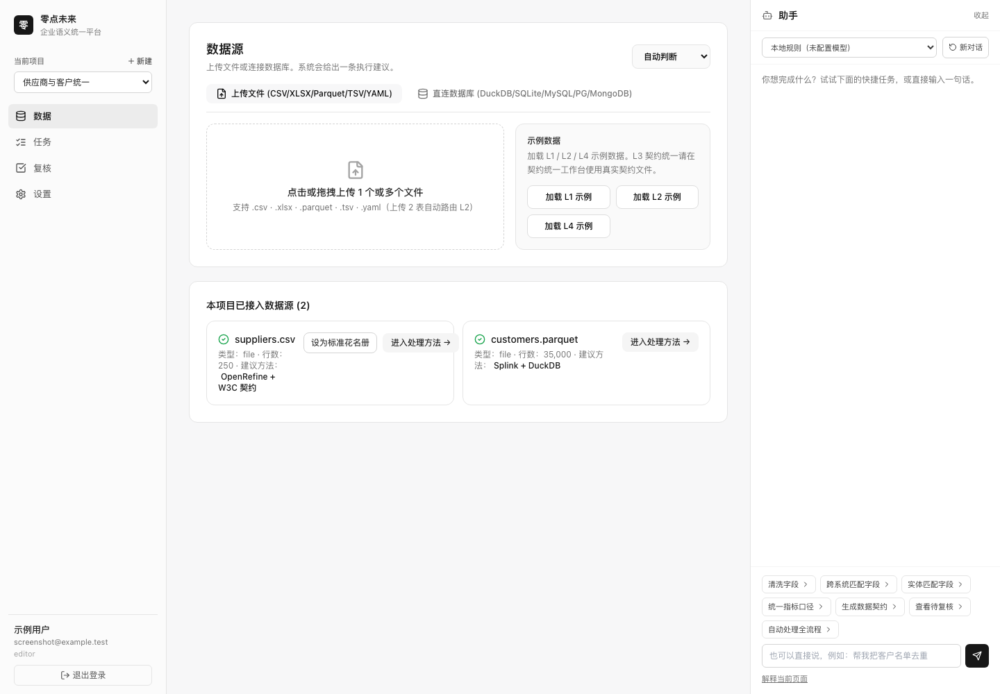

# Open Semantic Unifier

English | [简体中文](README.zh-CN.md)

Open Semantic Unifier is a self-hosted workbench for configurable entity resolution across business systems. Its first delivery focuses on persistent source identity, candidate evidence, human review, auditable identity changes, immutable snapshots, and version-bound exports.

The supplier, customer, and product examples are starting configurations. Projects can define other entity types and field mappings. L3 contract unification and L4 metric unification remain experimental and are not release claims. The V0.1 acceptance baseline has PASS evidence for all gates, including a clean GitHub Actions run; see [acceptance status](docs/reference/acceptance-status.json). Merge and deployment remain separate decisions.

## Quick start

Requirements: Docker with the Compose plugin, Python 3.11+ for the credential helper, and a free local port range 8000–9001.

```bash
python3 scripts/init_env.py
docker compose up -d --build
```

The helper creates a private `.env` with fresh JWT, encryption, database, object-store, and initial administrator credentials. Save the one-time administrator password printed by the helper. Do not deploy `.env.example` directly. To apply later `.env` changes, recreate the affected services:

```bash
docker compose up -d --force-recreate backend worker
```

Open the workbench at `http://localhost:8080`; API docs are at `http://localhost:8000/docs`. PostgreSQL data and MinIO objects persist in named Compose volumes. Database migrations run on API startup. To stop services while keeping data, run `docker compose down`. `docker compose down -v` deletes the database, object-store data, and optional Phoenix data.

## What is implemented

- Project-scoped source records and revisions with stable source keys.
- Configurable supplier, customer, product, and custom entity schemes.
- Rule and Splink candidate evidence, human review, merge/undo, snapshots, and exports.
- Asynchronous Celery run submission in the Compose deployment.
- Optional local or private OpenAI-compatible model providers.
- Optional OpenRefine sidecar for built-in cleaning recipes and before/after adoption; JSON-LD instances are generated from contract versions.
- Optional Phoenix tracing. It is not required for core matching.

Connector code paths exist for DuckDB, SQLite, MySQL, PostgreSQL, and MongoDB. The project has automated unit coverage for SQLite and DuckDB sinks and the Compose PostgreSQL deployment; live PostgreSQL, MySQL, and MongoDB connection tests are available as an opt-in job. See [connector validation](docs/how-to/connectors.md). Job results can be written directly to a target database, with persisted schedules for interval runs; see [writing results and scheduling](docs/how-to/etl.md).

## Screenshots

[](docs/screenshots.md)

[Open the screenshot tour](docs/screenshots.md) for the assistant field confirmation and readable entity review.

## Guides

- [Installation and operations](docs/how-to/install.md)
- [Three example scenarios](docs/how-to/scenarios.md)
- [API workflow](docs/how-to/api.md)
- [Contract unification](docs/how-to/contracts.md)
- [OpenRefine cleaning and W3C JSON-LD](docs/how-to/openrefine.md)
- [Decision models](docs/how-to/decision-models.md)
- [Guided assistant and review readability design](docs/superpowers/specs/2026-11-25-guided-assistant-design.md)
- [Decision model evaluation](docs/reference/decision-model-evaluation.md)
- [Database connectors and validation](docs/how-to/connectors.md)
- [Writing results to a database and scheduling runs](docs/how-to/etl.md)
- [Contribution guide](CONTRIBUTING.md)
- [Acceptance baseline and current status](docs/reference/acceptance-baseline.md)
- [Golden Test Set](tests/golden/README.md)

## Local development

```bash
python3 -m venv .venv
. .venv/bin/activate
python -m pip install -r backend/requirements.txt
python -m pytest backend/tests -q
npm --prefix frontend ci
npm --prefix frontend run build
```

Run `python3 scripts/golden.py validate` to check fixture integrity and `python3 -m unittest discover -s tests -p 'test_golden_contract.py' -v` to test the scorer contract. These commands validate fixtures and the scorer; they do not evaluate product predictions or satisfy lifecycle acceptance.

## Local models and tracing

Configure an OpenAI-compatible local or private model under **Providers**, then select it in a project scheme. The model can suggest review actions; configured conflicts and human cannot-link decisions remain authoritative. Start optional Phoenix with `docker compose --profile observability up -d phoenix` after setting `PHOENIX_ENABLED=true` in `.env` and recreating backend and worker. See the [installation guide](docs/how-to/install.md#optional-phoenix-tracing).

## License

Open Semantic Unifier is distributed under the MIT License. Third-party services and dependencies retain their own licenses; see [THIRD_PARTY_NOTICES.md](THIRD_PARTY_NOTICES.md).
