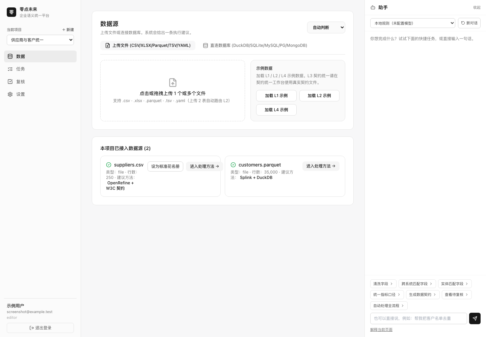

# Open Semantic Unifier

[English](README.md) | 简体中文

Open Semantic Unifier 是一个自托管的企业语义统一工作台，用于跨业务系统做可配置的实体解析。第一版交付聚焦于可持久化的来源身份、候选证据、人工复核、可审计的身份变更、不可变快照，以及绑定版本的导出。

供应商、客户、产品示例只是初始配置。项目可以定义其他实体类型和字段映射。L3 契约统一和 L4 指标统一仍是实验性能力，不作为发布承诺。V0.1 验收基线已为所有门禁保留 PASS 证据，包括一次干净的 GitHub Actions 运行；详见[验收状态](docs/reference/acceptance-status.json)。合并与部署仍是独立决策。

## 快速开始

环境要求：Docker 与 Compose 插件、Python 3.11+（用于凭据生成脚本），以及 8000–9001 的空闲本地端口。

```bash
python3 scripts/init_env.py
docker compose up -d --build
```

脚本会创建私有 `.env`，内含新的 JWT、加密密钥、数据库、对象存储和初始管理员凭据。请保存脚本只打印一次的管理员密码。不要把 `.env.example` 直接用于部署。修改 `.env` 后，重建受影响的服务：

```bash
docker compose up -d --force-recreate backend worker
```

打开 `http://localhost:8080` 使用工作台，API 文档在 `http://localhost:8000/docs`。PostgreSQL 数据和 MinIO 对象保存在 Compose 命名卷中。API 启动时会自动执行数据库迁移。停止服务但保留数据：

```bash
docker compose down
```

`docker compose down -v` 会删除数据库、对象存储数据和可选的 Phoenix 数据。

## 已实现内容

- 项目级来源记录与修订，来源键稳定。
- 可配置的供应商、客户、产品及自定义实体方案。
- 规则与 Splink 候选证据、人工复核、合并/撤销、快照和导出。
- Compose 部署中的 Celery 异步运行提交。
- 可选的本地或私有 OpenAI 兼容模型 Provider。
- 可选 OpenRefine sidecar：内置清洗配方、清洗前后 diff、采用后生成新数据源；契约版本可导出 JSON-LD 实例。
- 可选 Phoenix 追踪，不是核心匹配的必需项。

连接器代码覆盖 DuckDB、SQLite、MySQL、PostgreSQL 和 MongoDB。项目对 SQLite、DuckDB 落库以及 Compose PostgreSQL 部署有自动化单元覆盖；PostgreSQL、MySQL、MongoDB 的实时连接测试作为可选 CI 作业运行。详见[连接器验证](docs/how-to/connectors.md)。Job 结果可以直接写入目标数据库，并支持按间隔运行的持久化调度；详见[写入目标库与调度](docs/how-to/etl.md)。

## 系统截图

[](docs/screenshots.zh-CN.md)

更多截图见[系统截图页](docs/screenshots.zh-CN.md)，包括助手字段确认和可读的实体复核。

## 指南

- [安装与运维](docs/how-to/install.md)
- [三个示例场景](docs/how-to/scenarios.md)
- [API 工作流](docs/how-to/api.md)
- [契约统一](docs/how-to/contracts.md)
- [OpenRefine 清洗与 W3C JSON-LD](docs/how-to/openrefine.md)
- [决策模型](docs/how-to/decision-models.md)
- [新手引导与复核可读性设计](docs/superpowers/specs/2026-11-25-guided-assistant-design.md)
- [决策模型评测](docs/reference/decision-model-evaluation.md)
- [数据库连接器与验证](docs/how-to/connectors.md)
- [写入目标库与调度运行](docs/how-to/etl.md)
- [贡献指南](CONTRIBUTING.md)
- [验收基线与当前状态](docs/reference/acceptance-baseline.md)
- [Golden Test Set](tests/golden/README.md)

## 本地开发

```bash
python3 -m venv .venv
. .venv/bin/activate
python -m pip install -r backend/requirements.txt
python -m pytest backend/tests -q
npm --prefix frontend ci
npm --prefix frontend run build
```

运行 `python3 scripts/golden.py validate` 检查 Golden 夹具完整性，运行 `python3 -m unittest discover -s tests -p 'test_golden_contract.py' -v` 测试评分器契约。这些命令验证夹具和评分器，不评估产品预测，也不代表满足生命周期验收。

## 本地模型与追踪

在 **Providers** 中配置 OpenAI 兼容的本地或私有模型，然后在项目方案中选择它。模型可以建议复核动作；已配置的冲突规则和人工“不能合并”决定仍然具有最终约束力。如需可选 Phoenix，先在 `.env` 中设置 `PHOENIX_ENABLED=true` 并重建 backend 和 worker，再运行：

```bash
docker compose --profile observability up -d phoenix
```

详见[安装指南](docs/how-to/install.md#optional-phoenix-tracing)。

## 许可证

Open Semantic Unifier 使用 MIT License 发布。第三方服务和依赖保留各自许可证；详见 [THIRD_PARTY_NOTICES.md](THIRD_PARTY_NOTICES.md)。
