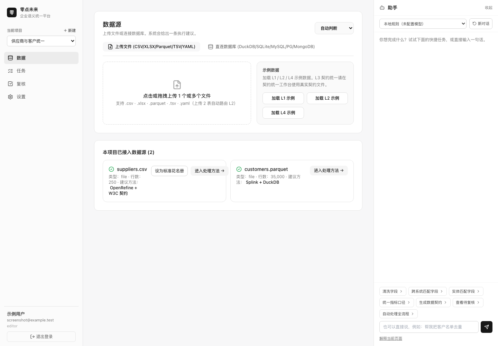
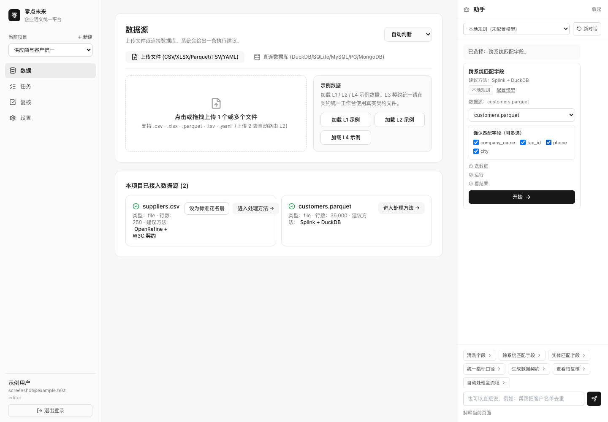
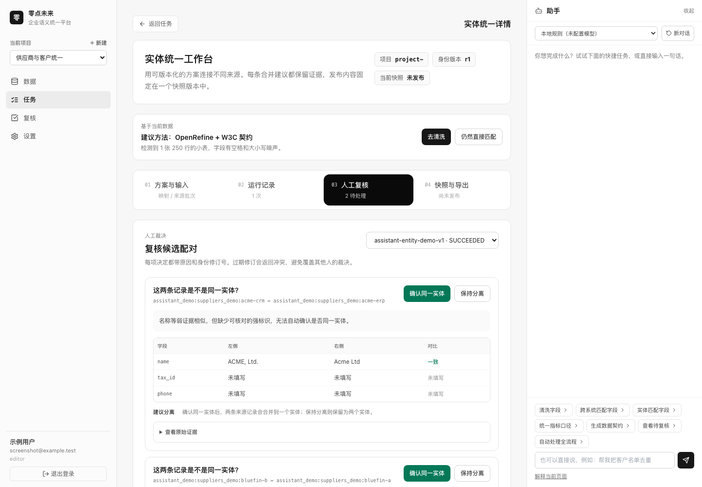

# Screenshot tour

These screenshots come from a seeded demo project. No customer or credential data is shown. The capture is reproducible with `frontend/tests/capture_screenshots.py`.

## Workbench overview

The four-menu shell keeps data, tasks, reviews, and settings in one place. Each data source shows its recommended processing method; the assistant stays available on the right.

## Assistant field confirmation

The assistant proposes the task and method, then asks the user to confirm one or more match fields before running. The selected source and fields are part of the plan.

## Readable entity review

Review cards explain why the pair needs a decision, compare fields side by side, and state the consequence. Raw evidence stays collapsed until requested.

