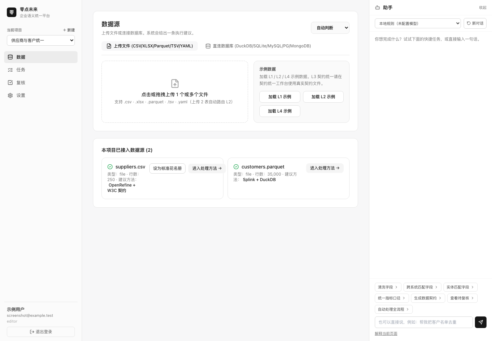
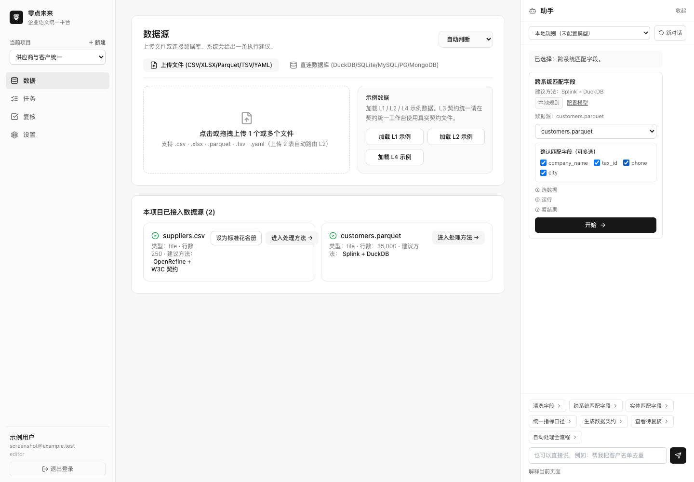
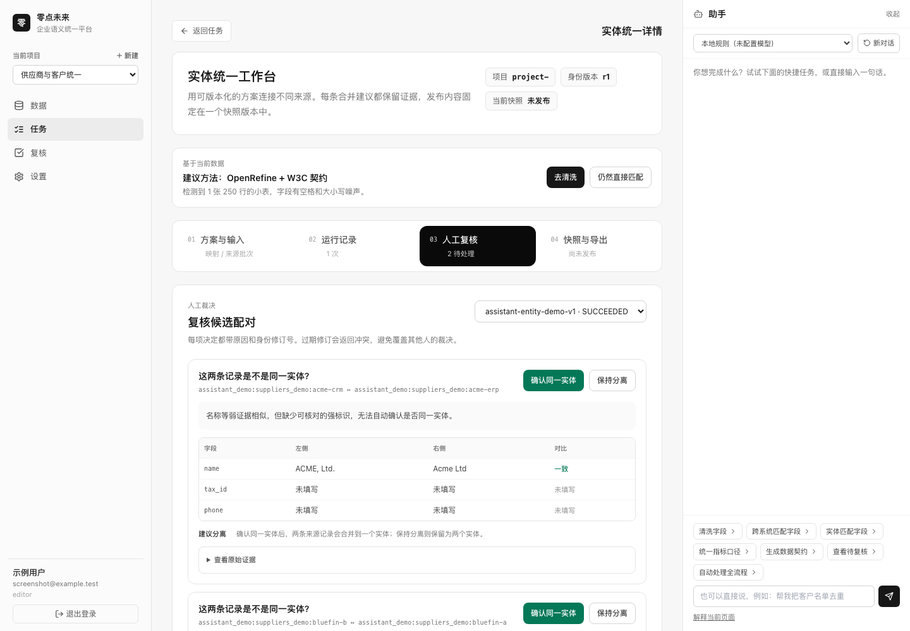

# 系统截图

以下截图来自一个预置的演示项目，不包含客户数据或凭据。可通过 `frontend/tests/capture_screenshots.py` 重新生成。

## 工作台总览

四个一级菜单把数据、任务、复核和设置放在同一处。每个数据源显示建议的处理方法，右侧助手始终可用。

## 助手字段确认

助手先提出任务和方法，再请用户确认一个或多个匹配字段后才开始运行。所选数据源和字段会进入计划。

## 可读的实体复核

复核卡片说明为什么需要判断、并排比较字段，并说明处理后果。原始证据默认折叠，需要时再展开。

